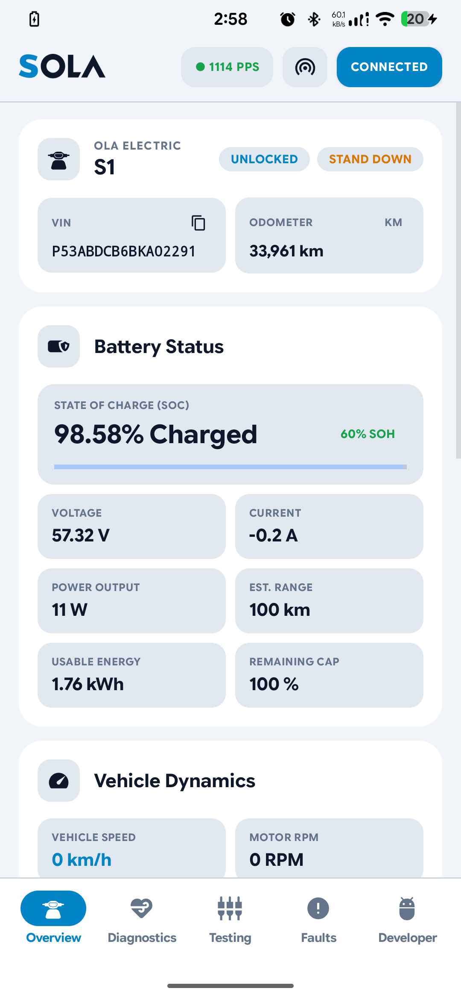
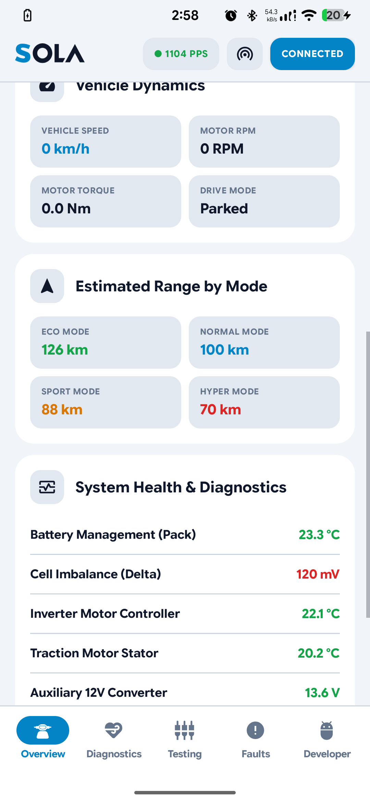
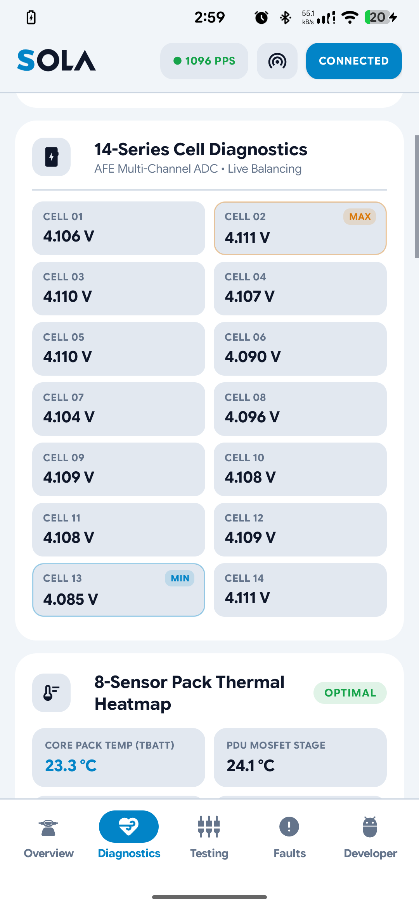
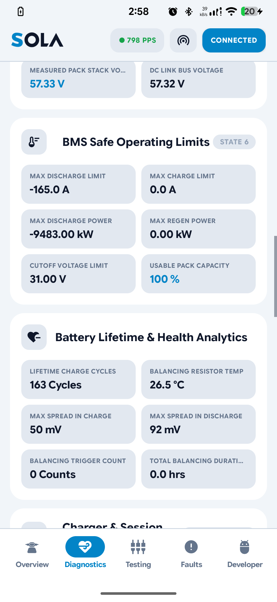
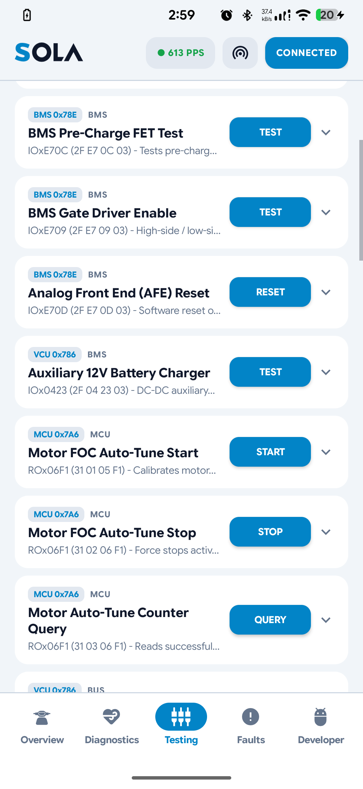
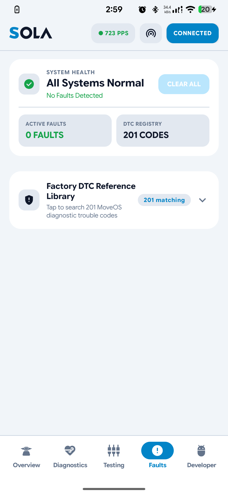
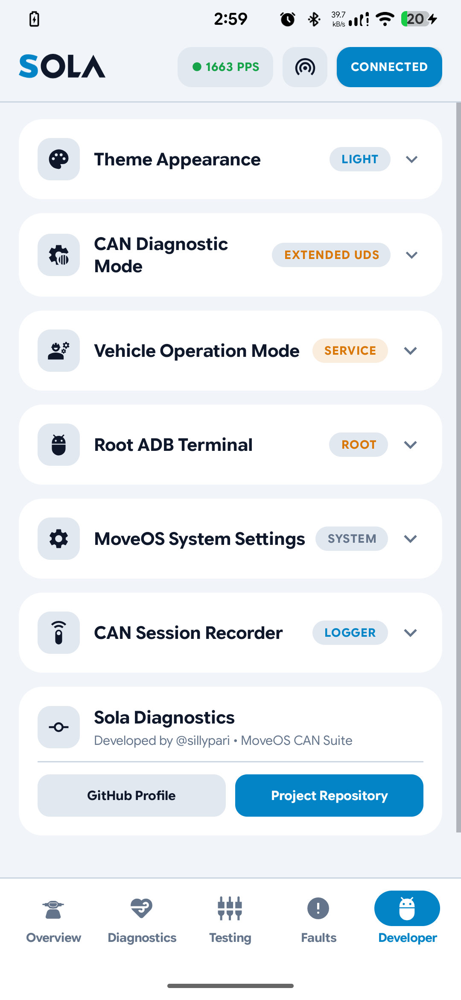

<div align="center">

# SOLA

### Next-Generation Ola S1 Telemetry, Diagnostics & MoveOS CAN Suite

[](https://android.com)
[](https://olaelectric.com)
[](https://en.wikipedia.org/wiki/CAN_bus)
[](#high-performance-zero-allocation-engine)
[](#clean-material-3-interface)

<p align="center">
  <b>Sola</b> is a high-performance Android diagnostics and live telemetry suite designed for Ola Electric scooters (S1, S1 Pro, S1 Air, S1X).
  Connecting directly to the vehicle daemon via Wi-Fi hotspot or local network, Sola decodes real-time vehicle CAN bus traffic at over <b>1,500 packets per second</b> with zero latency, zero frame drops, and professional-grade precision.
</p>

---

</div>

## Key Capabilities at a Glance

* **Live Battery & Range Telemetry** — High-precision 0.01% state of charge (SOC), real-time current draw, pack voltage, calculated SOH, and range predictions across Eco, Normal, Sport, and Hyper modes.
* **14-Series Cell Diagnostics & Balancing** — Individual cell millivolt readings (Cell 01 through Cell 14), live cell delta tracking, active passive balancing flags, and 8-sensor thermal heatmap.
* **Unified System Health Monitoring** — Real-time status for the Battery Management System (BMS), Inverter Motor Controller (MCU), Traction Motor, 12V DC-DC Auxiliary Converter, High Voltage Contactors, and Electronic Steering Column Lock (ESCL).
* **Extended UDS Diagnostics (ISO 14229 / ISO 15765-2)** — Native ISO-TP multi-frame reassembly for reading ECU Identifiers (DIDs), initiating Motor Field-Oriented Control (FOC) auto-tune routines, testing Pre-Charge FETs, and resetting Analog Front End (AFE) silicon.
* **Factory DTC Fault Engine** — Real-time CAN fault decoder and offline searchable library of 201 MoveOS diagnostic trouble codes.
* **MoveOS Developer Suite** — 1-click scooter operation mode switcher (`CUSTOMER` vs `SERVICE`), root ADB terminal with instant presets, and high-speed candump session logger.

---

## App Interface & Core Features

### 1. Overview & Vehicle Hero
The Overview tab presents scooter telemetry at a glance with live interlock statuses, vehicle identification, and dynamic range predictions.

<div align="center">
  
</div>

* **Vehicle Hero Card** — Real-time side stand status (`ARMED` / `STAND DOWN`), lock state (`LOCKED` / `UNLOCKED`), copyable vehicle VIN (`P53ABDCB6BKA02291`), and lifetime odometer readings.
* **Live Battery Status** — High-precision pack state of charge (`98.58% Charged`), calculated state of health, instantaneous pack voltage, charge/discharge amperage, and net wattage.
* **Dynamic Range Estimations** — Real-time estimated range in kilometers across Eco, Normal, Sport, and Hyper riding modes.

---

### 2. System Health & Diagnostics
A clean, uncluttered health dashboard monitoring all major high-voltage and low-voltage subsystems with state-colored telemetry indicators.

<div align="center">
  
</div>

* **Battery Management (Pack)** — Core battery pack temperature with thermal alert thresholds.
* **Cell Imbalance (Delta)** — Millivolt spread between the highest and lowest cells (`161 mV`), highlighted in real-time alert colors.
* **Inverter Motor Controller (MCU)** — Mosfet power stage thermal monitoring.
* **Traction Motor Stator** — Drive unit stator coil temperature.
* **Auxiliary 12V Converter** — Low-voltage DC-DC converter output voltage (`13.6 V`).
* **High Voltage Contactors** — Contactor engagement state and DC bus link voltage.
* **Steering Column Lock (ESCL)** — Hardware locking pin status (`UNLOCKED`, `LOCKED`, `MOVING`).
* **DTC & Fault Monitor** — Live fault monitor reporting active CAN trouble codes.

---

### 3. 14-Series Cell Diagnostics & Balancing Matrix
Inspect every individual lithium-ion cell in the pack with Analog Front End (AFE) multi-channel ADC precision.

<div align="center">
  
</div>

* **Per-Cell Voltages** — Millivolt-accurate readings across all 14 series cells (Cells 01 to 14).
* **Automatic Peak Detection** — Dynamically highlights the maximum voltage cell (`MAX`) and minimum voltage cell (`MIN`).
* **Live Balancing Indication** — Real-time indicator badges whenever the BMS engages passive bleed resistors on individual cells.
* **Pack Thermal Heatmap** — 8-point temperature matrix including core pack cells and PDU MOSFET stages.

---

### 4. BMS Safe Operating Limits & Lifetime Analytics
Provides insight into the scooter's safety envelope and battery wear over time.

<div align="center">
  
</div>

* **BMS Safe Operating Limits** — Maximum discharge current limit (`-165.0 A`), charge current limit, maximum discharge power (`-9.48 kW`), regen power envelope, and lower cutoff voltage.
* **Battery Lifetime & Health Analytics** — Lifetime charge cycle counter, balancing resistor temperature, maximum cell spread observed during charging, and lifetime balancing duration.

---

### 5. ECU Testing & UDS Routine Controls
Direct actuator and calibration controls powered by Unified Diagnostic Services (UDS).

<div align="center">
  
</div>

* **BMS Pre-Charge FET Test (`IOxE70C`)** — Validates pre-charge circuit functionality.
* **BMS Gate Driver Enable (`IOxE709`)** — Tests high-side and low-side switching stages.
* **AFE Silicon Reset (`IOxE70D`)** — Soft-reboots the battery Analog Front End chip.
* **Auxiliary 12V Charger Test (`IOx0423`)** — Tests the DC-DC buck converter.
* **Motor FOC Auto-Tune (`ROx06F1`)** — Initiates and monitors traction motor stator calibration.

---

### 6. DTC Fault Engine & 201 MoveOS Codes
Detects and explains vehicle trouble codes in plain language with no guesswork.

<div align="center">
  
</div>

* **Active CAN Fault Monitor** — Scans incoming CAN frames continuously for triggered warning flags.
* **Factory DTC Reference Library** — Built-in catalog of 201 MoveOS diagnostic trouble codes covering BMS, MCU, VCU, TCU, and HU systems with descriptions and recovery steps.

---

### 7. Developer Hub & MoveOS Tools
Essential utilities for reverse engineering, research, and advanced scooter management.

<div align="center">
  
</div>

* **Vehicle Operation Mode Switcher** — Toggles between `CUSTOMER` (standard end-user mode) and `SERVICE` (technician mode with open ports and diagnostics).
* **Root ADB Terminal** — Built-in terminal emulator with single-tap preset buttons (`ps | grep ola`, `dmesg`, `logcat`, `getprop`, `ip route`).
* **CAN Session Recorder** — Records high-speed raw CAN frames to standard SocketCAN `.log` / `.candump` files for playback in SavvyCAN, Vector CANoe, or Wireshark.

---

## High-Performance Zero-Allocation Engine

Unlike generic OBD tools that drop frames under load, Sola's engine is built for continuous 500 kbps automotive streams:

| Optimization | Traditional Implementation | Sola Engine | Benefit |
| :--- | :--- | :--- | :--- |
| **DBC Decoding** | Linear message map lookups | Direct array indexing `dbc.message(id)` | **O(1)** instant lookup |
| **Per-Frame Allocations** | Boxing `Double` / `Long` in HashMaps | Direct primitive arrays (`double[]`, `long[]`) | **0 bytes** heap allocation |
| **Log Ring Buffer** | Allocating `Entry` + `String.format` | Circular buffer of reusable `RawLogEntry[500]` | **~17,000 fewer objects/sec** |
| **CAN Recorder** | `String.format` per byte | 256-entry static lookup table `HEX_BYTES` | Zero string garbage |
| **UI Snapshot Caching** | Synchronized full map traversal at 10 Hz | Double-buffered snapshot with volatile publish | **Zero UI jank or GC stutter** |
| **UDS ISO-TP Protocol** | Single-frame only | Full ISO-TP (`IsoTpAssembler`) multi-frame support | Multi-packet VIN/DTC decode |

---

## Connection Setup

1. **Connect Scooter to Wi-Fi / Hotspot:**
   * Enable Mobile Hotspot on your Android phone or connect both the phone and scooter to the same Wi-Fi network.
   * On your scooter dash: go to **Settings > Wi-Fi** and connect to your hotspot.
2. **Launch Sola:**
   * Tap the **Hotspot** button in Sola's top bar to auto-detect the scooter's IP address (default subnet `192.168.43.x` or `192.168.1.x`).
   * Tap **Connect**.
3. **Telemetry Starts Instantly:**
   * Watch the live throughput badge update in real-time (`● 1500+ PPS`).

---

## Building from Source

### Prerequisites
* Android Studio Ladybug or newer
* Android SDK 34+
* JDK 17+

### Build APK
Clone the repository and build the standard debug APK:

```bash
git clone https://github.com/sillypari/Sola.git
cd Sola
./gradlew :app:assembleStandardDebug
```

The compiled APK will be generated at:
`app/build/outputs/apk/standard/debug/app-standard-debug.apk`

Install directly to an authorized device via ADB:
```bash
adb install -r app/build/outputs/apk/standard/debug/app-standard-debug.apk
```

---

## Safety & Disclaimers

> [!IMPORTANT]
> **Read-Only by Default**: Normal monitoring in Sola is strictly passive. Sola does not send unsolicited control frames that could interfere with driving safety.
> 
> **Service Mode Cautions**: The vehicle operation mode switcher modifies MoveOS system properties. Ensure the scooter is parked and safely positioned on its center stand before testing actuator routines.

---

## Author & Credits

* Developed by **[@sillypari](https://github.com/sillypari)**
* Project Repository: [https://github.com/sillypari/Sola](https://github.com/sillypari/Sola)
